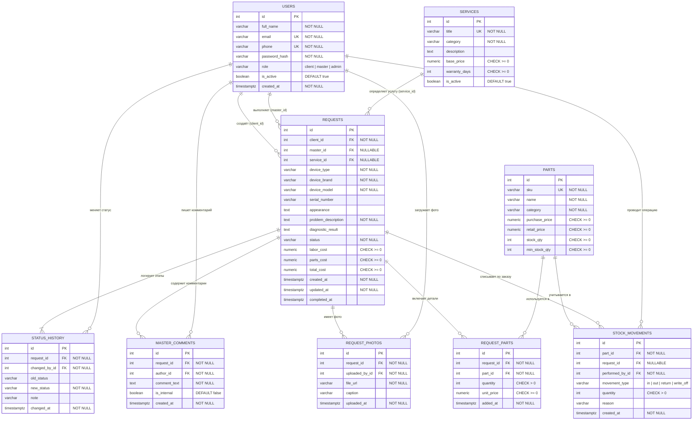

# Пояснительная записка к проекту «Ремонтная мастерская»

---

# 1. Анализ предметной области и обзор существующих решений

## 1.1. Характеристика предметной области и участники процесса

Сервисные центры (СЦ) по ремонту электроники (смартфонов, ноутбуков, ПК, бытовой и офисной техники) работают в условиях высокой операционной динамики: одновременно в мастерской могут находиться десятки и сотни устройств на разных стадиях обслуживания. Ключевая задача информационной системы сервисного центра — обеспечить прозрачный, контролируемый жизненный цикл каждой заявки (заказ-наряда) от момента обращения владельца устройства до завершения ремонта и выдачи техники.

В информационном взаимодействии внутри ремонтной мастерской выделяются три основные группы участников (роли):

1. **Клиент (`client`)** — владелец неисправного устройства. Инициирует заявку на ремонт, передаёт устройство в сервисный центр, отслеживает текущий статус диагностики и ремонта в личном кабинете, согласовывает стоимость и сроки работ, принимает отремонтированное устройство и оплачивает услуги.
2. **Мастер / Инженер СЦ (`master`)** — технический специалист, непосредственно выполняющий диагностику и ремонт. Принимает назначенные ему заявки в работу, фиксирует выявленные неисправности, формирует перечень необходимых работ и комплектующих, обновляет технический статус заказа по мере прохождения этапов ремонта и проводит итоговое тестирование устройства.
3. **Администратор / Приёмщик / Руководитель (`admin`)** — координирующее звено сервисного центра. Оформляет приёмку и выдачу устройств, проверяет комплектацию и внешний вид техники, распределяет заказы между мастерами с учётом их специализации и текущей загрузки, контролирует соблюдение сроков, управляет учётными записями пользователей, прейскурантом услуг и формирует сводную отчётность по работе мастерской.

---

## 1.2. Бизнес-процесс обслуживания устройства: от приёма до выдачи

Типовой сквозной бизнес-процесс сервисного центра включает семь последовательных этапов:

1. **Обращение и приём устройства (регистрация заявки).** Клиент оставляет предварительную заявку через веб-интерфейс или обращается непосредственно в пункт приёма. Фиксируются контактные данные клиента, категория, марка, модель и серийный номер (IMEI) устройства, комплектация (зарядное устройство, чехол и т. д.), состояние корпуса (царапины, сколы, следы вскрытия) и описание симптомов неисправности со слов владельца. Заказу присваивается уникальный номер и начальный статус *«Принят / Новый»*.
2. **Назначение исполнителя.** Администратор оценивает характер поломки и назначает ответственного мастера соответствующего профиля, переводя заказ в рабочий контур специалиста.
3. **Первичная и углублённая диагностика.** Мастер проводит аппаратную или программную диагностику устройства, устанавливает точную причину неисправности, определяет перечень необходимых запчастей, стоимость и ориентировочную длительность ремонта. Статус заказа меняется на *«На диагностике»*, а по её завершении — на *«Ожидает согласования»*.
4. **Согласование условий ремонта с клиентом.** Клиент знакомится с техническим заключением и итоговой сметой. В случае согласия заказ переходит в статус *«В работе (На ремонте)»*. Если ремонт экономически нецелесообразен или клиент отказывается от условий, фиксируется *«Отказ от ремонта»*, и устройство передаётся на сборку для возврата владельцу.
5. **Выполнение ремонта и комплектация.** При необходимости заказа редких деталей заявка временно переводится в статус *«Ожидает запчастей»*. После установки комплектующих и устранения дефекта мастер проводит выходной контроль качества (тестирование основных узлов устройства под нагрузкой).
6. **Готовность к выдаче и информирование.** После успешного тестирования мастер переводит заявку в статус *«Готов к выдаче»*. Клиент оперативно видит изменение статуса в личном кабинете.
7. **Выдача устройства и закрытие заказа.** Клиент проверяет исправность техники, производит окончательный расчёт, получает гарантийные документы. Администратор переводит заявку в финальный статус *«Выдан / Закрыт»*, после чего заказ сохраняется в архиве истории обслуживания.

---

## 1.3. Типичные проблемы сервисных центров

При отсутствии специализированной информационной системы (ведение учёта в таблицах Excel, мессенджерах или бумажных журналах) либо при использовании неподходящего ПО сервисные центры сталкиваются со следующими проблемами:

* **Информационный вакуум для клиента и высокая нагрузка на приёмку.** Клиенты не знают, на каком этапе находится их устройство, и регулярно звонят в сервис с вопросом «Когда будет готово?». Это отнимает до 30–40% рабочего времени администраторов и отвлекает мастеров.
* **Потеря истории и путаница в заказах.** При ручном учёте теряются комментарии о скрытых дефектах, согласованной стоимости, комплектации или сроках ожидания деталей, что приводит к прямым финансовым убыткам и репутационным потерям.
* **Отсутствие строгого разграничения прав доступа.** Когда все сотрудники работают в одной общей таблице или под одной учётной записью, невозможно отследить, кто изменил цену, удалил заявку или перевёл незавершённый заказ в статус готового.
* **«Зависшие» заказы и неравномерная загрузка мастеров.** Без наглядной фильтрации по статусам и исполнителям часть устройств после диагностики остаётся лежать на полках без движения, а нагрузка между инженерами распределяется хаотично.
* **Конфликты при выдаче оборудования.** Отсутствие прозрачной фиксации этапов диагностики и согласованной сметы порождает споры с клиентами относительно итоговой суммы и перечня выполненных работ.

---

## 1.4. Сравнительный анализ существующих аналогов (CRM для сервисных центров)

Для оценки представленных на рынке решений проведён анализ пяти популярных CRM/ERP-систем, применяемых в сфере ремонта электроники (таблица 1).

**Таблица 1 — Сравнение существующих CRM-систем для сервисных центров**

| Название | Ключевые функции | Плюсы | Минусы | Чего не хватает |
| :--- | :--- | :--- | :--- | :--- |
| **RemOnline (RO App)** | Учёт заказов, складской и финансовый учёт, база клиентов, печать квитанций, расчёт зарплаты мастеров, интеграции с телефонией и SMS. | Богатый функционал, продуманный интерфейс, гибкая настройка статусов и шаблонов документов, мобильное приложение для сотрудников. | Высокая стоимость подписки (особенно при росте числа сотрудников), облачная зависимость, ограничения доступности и оплаты в РФ. | Полноценного личного кабинета для клиента (есть только внешний виджет проверки статуса по номеру заказа), возможности бесплатного self-hosted развёртывания. |
| **HelloClient** | Журнал заявок, склад запчастей, касса, печать документов по шаблонам, SMS/WhatsApp-оповещения, базовая аналитика. | Быстрый старт, простой и современный веб-интерфейс, меньшая стоимость по сравнению с крупными ERP. | Только облачная модель (SaaS), ограниченные возможности кастомизации бизнес-логики под нестандартные процессы мастерской. | Интерактивного клиентского портала (подача новых заявок и просмотр истории всех своих устройств онлайн самим клиентом). |
| **Gincore** | Учёт ремонтов и продаж, адресное хранение на складе, логистика запчастей между филиалами, KPI сотрудников, телефония. | Глубокая автоматизация складской логистики и серийного учёта деталей, поддержка разветвлённой сети филиалов. | Перегруженный и сложный в освоении интерфейс, высокий порог входа для небольших и средних мастерских, высокая абонентская плата. | Лёгкого и интуитивного интерфейса для мастеров и клиентов без избыточных бухгалтерско-складских модулей. |
| **Livesklad** | Приём и ведение заказов, склад и закупки, онлайн-касса, расчёт мотивации мастеров, виджет статуса ремонта на сайт. | Адаптация под локальный рынок и онлайн-кассы, удобная карточка заказа, встроенные интеграции с поставщиками запчастей. | Привязка к проприетарному облаку, тарифные ограничения по числу пользователей и точек, закрытый исходный код. | Двустороннего личного кабинета клиента с историей обращений и прямой подачей заявок внутри единой системы. |
| **1С:Управление сервисным центром** | Полный контур регламентированного, складского, финансового и ремонтного учёта, ордерные склады, гарантийный ремонт. | Локальное хранение данных (on-premise), полная интеграция с бухгалтерией 1С, высокая детализация учёта. | Устаревший и крайне сложный UX/UI, высокая стоимость лицензий и сопровождения (требуется штатный или приходящий программист 1С). | Современного легковесного веб-интерфейса для быстрой работы из браузера и удобного клиентского веб-кабинета. |

---

## 1.5. Выводы: чем полезен разрабатываемый проект

Анализ предметной области и существующих CRM-решений показывает, что большинство тиражных систем на рынке ориентированы на крупные сети сервисных центров и представляют собой тяжёлые коммерческие SaaS-комбайны. При этом в них наблюдается общий недостаток: **клиент исключён из единого информационного контура системы** (взаимодействие с ним сводится к платным SMS-рассылкам или одностороннему виджету проверки квитанции), а сами системы требуют регулярной абонентской платы, содержат избыточные модули и не позволяют развернуть решение на собственной инфраструктуре с открытым кодом.

Разрабатываемый веб-проект **«Ремонтная мастерская»** (стек: **FastAPI, SQLAlchemy 2.0, Alembic, PostgreSQL, JWT, Vanilla JS**) решает выявленные проблемы и обладает следующими практическими преимуществами:

1. **Единое пространство для всех трёх ролей (`client`, `master`, `admin`).** В отличие от классических внутренних CRM, клиент получает полноценный личный кабинет, где может самостоятельно оформить заявку, отслеживать актуальный этап ремонта в реальном времени и просматривать историю всех своих обращений, что существенно снижает нагрузку на администраторов.
2. **Строгая безопасность и разграничение ответственности.** Использование JWT-аутентификации и ролевых проверок (`require_role`) на уровне бэкенда гарантирует, что клиент видит только свои заявки, мастер управляет техническим процессом назначенных ему ремонтов, а администратор контролирует весь цикл работы мастерской.
3. **Фокус на целевом бизнес-процессе без перегруженности интерфейса.** Лаконичный фронтенд на чистом JavaScript (`Vanilla JS`) без тяжёлых сторонних фреймворков обеспечивает мгновенный отклик интерфейса и минимальный порог вхождения для персонала и клиентов.
4. **Надёжность данных и архитектурная прозрачность.** Применение современного стека (`FastAPI` + `SQLAlchemy 2.0` + `PostgreSQL`), строгой валидации входных данных через `Pydantic` с понятными сообщениями об ошибках на русском языке и версионирования схемы БД через `Alembic` исключает потерю данных и упрощает дальнейшее развитие и масштабирование системы.
5. **Независимость от внешних облачных подписок (On-Premise / Self-Hosted).** Мастерская может развернуть систему на собственном сервере без ежемесячных платежей за каждого сотрудника и без риска потери доступа к базе клиентов из-за блокировки стороннего SaaS-сервиса.

---

# 2. Спецификация требований к информационной системе

## 2.1. Функциональные требования (MoSCoW)

Приоритизация функциональных требований выполнена по методологии **MoSCoW**:
* **Must** — обязательные требования первого приоритета, без которых система не может эксплуатироваться;
* **Should** — важные требования второго приоритета, существенно повышающие удобство и прозрачность работы;
* **Could** — дополнительные (бонусные) функции, реализуемые при наличии резерва времени.

**Таблица 2 — Функциональные требования к системе «Ремонтная мастерская»**

| ID | Роль | Требование | Приоритет |
| :--- | :--- | :--- | :---: |
| **FR-01** | Гость / Все роли | Регистрация новой учётной записи клиента (`client`) и аутентификация пользователей всех ролей по логину (e-mail/телефону) и паролю с выдачей подписанного JWT-токена. | **Must** |
| **FR-02** | Все роли | Ролевая защита эндпоинтов API через зависимость `require_role` и отображение интерфейса в соответствии с ролью пользователя (`client`, `master`, `admin`). | **Must** |
| **FR-03** | Клиент (`client`) | Создание новой заявки на ремонт с указанием типа устройства, бренда, модели, серийного номера (IMEI), комплектации и подробного описания неисправности. | **Must** |
| **FR-04** | Клиент (`client`) | Просмотр списка собственных заявок (активных и завершённых), детальной карточки заказа, текущего статуса ремонта, технического заключения мастера и итоговой стоимости. | **Must** |
| **FR-05** | Мастер (`master`) | Просмотр списка назначенных мастеру заявок с возможностью фильтрации по текущему этапу ремонта и срочности. | **Must** |
| **FR-06** | Мастер (`master`) | Внесение результатов диагностики, формирование сметы ремонта (выбор выполненных работ и использованных запчастей) и поэтапная смена статуса заявки (*«На диагностике»*, *«Ожидает согласования»*, *«В ремонте»*, *«Ожидает запчастей»*, *«Готов к выдаче»*). | **Must** |
| **FR-07** | Администратор (`admin`) | Просмотр полного реестра заявок мастерской с поиском и фильтрацией (по статусу, клиенту, мастеру, дате), назначение и переназначение ответственного мастера, перевод заказа в финальный статус (*«Выдан / Закрыт»*, *«Отменён»*). | **Must** |
| **FR-08** | Администратор (`admin`) | Управление учётными записями пользователей: создание профилей мастеров (`master`) и администраторов (`admin`), изменение ролей, блокировка неактивных сотрудников. | **Must** |
| **FR-09** | Администратор (`admin`) | Ведение справочников типовых ремонтных услуг и склада запчастей (добавление позиций, редактирование базовой стоимости и остатков). | **Must** |
| **FR-10** | Клиент (`client`) | Онлайн-согласование или отказ от предложенной мастером стоимости и сроков ремонта непосредственно из личного кабинета (для заявок в статусе *«Ожидает согласования»*). | **Should** |
| **FR-11** | Все роли | Автоматическое ведение и просмотр истории (таймлайна) изменений статуса заказа с фиксацией даты, времени, автора изменения и комментария. | **Should** |
| **FR-12** | Администратор (`admin`) | Просмотр сводной аналитики и статистики работы сервисного центра: количество заявок по статусам, общая выручка за выбранный период, распределение нагрузки по мастерам. | **Should** |
| **FR-13** | Клиент (`client`) | Возможность оставить оценку (от 1 до 5) и текстовый отзыв о качестве обслуживания после перехода заявки в статус *«Выдан / Закрыт»*. | **Should** |
| **FR-14** | Администратор (`admin`), Клиент (`client`) | Генерация и выгрузка печатной квитанции о приёме устройства и акта выполненных работ в формате **PDF**. | **Could** |
| **FR-15** | Администратор (`admin`), Клиент (`client`) | Формирование уникального **QR-кода** для каждой заявки (в карточке заказа и на квитанции) для мгновенного открытия страницы статуса ремонта с камеры смартфона. | **Could** |
| **FR-16** | Система / Клиент (`client`) | Автоматическая отправка **e-mail** уведомлений клиенту при переходе заявки в ключевые статусы (*«Ожидает согласования»*, *«Готов к выдаче»*). | **Could** |
| **FR-17** | Мастер (`master`), Администратор (`admin`) | Отображение и оперативное управление потоком заявок в режиме интерактивной **Kanban-доски** с перетаскиванием карточек между колонками статусов (Drag-and-Drop). | **Could** |

---

## 2.2. Нефункциональные требования с измеримыми критериями

**Таблица 3 — Нефункциональные требования (NFR) и критерии их проверки**

| ID | Категория | Описание требования | Измеримый критерий (метрика приёмки) |
| :--- | :--- | :--- | :--- |
| **NFR-01** | Производительность бэкенда | Высокая скорость обработки HTTP-запросов к REST API (FastAPI + SQLAlchemy 2.0). | Время отклика сервера по 95-му перцентилю (`p95`) для типовых операций (получение списка заявок, карточки заказа, смена статуса) **≤ 200 мс** при одновременной работе до 50 пользователей. |
| **NFR-02** | Производительность фронтенда | Быстрая загрузка и отзывчивость клиентской части на чистом JavaScript (`Vanilla JS`) без тяжёлых фреймворков. | Время отрисовки интерфейса (`DOMContentLoaded` / `First Contentful Paint`) **≤ 1,2 с** при скорости канала 10 Мбит/с; суммарный размер собственных HTML/CSS/JS-файлов **≤ 300 КБ**. |
| **NFR-03** | Безопасность и контроль доступа | Защита персональных данных, паролей и закрытых маршрутов API с помощью JWT и ролевых проверок. | **100%** защищённых эндпоинтов проверяют JWT и роль через `require_role` (при нарушении возвращается `401`/`403` менее чем за **50 мс**); пароли хешируются алгоритмом `bcrypt` (cost factor **≥ 12**); время жизни access-токена — **60 минут**. |
| **NFR-04** | Безопасность и целостность БД | Защита от SQL-инъекций и строгое версионирование схемы базы данных PostgreSQL. | **0** SQL-запросов со строковой конкатенацией в коде проекта (100% запросов через ORM SQLAlchemy 2.0 с параметризацией); **100%** изменений схемы БД накатываются и откатываются через миграции `Alembic` (`alembic upgrade head`) без ошибок. |
| **NFR-05** | Валидация и локализация ошибок | Проверка корректности всех входных параметров и понятная обратная связь для русскоязычных пользователей. | **100%** входных моделей запросов проходят валидацию через `Pydantic`; при передаче некорректных данных API в **100%** случаев возвращает код `400`/`422` с текстом ошибки на **русском языке**. |
| **NFR-06** | Архитектура и сопровождаемость кода | Строгое разделение слоёв бизнес-логики и транспортного уровня на бэкенде и фронтенде. | **100%** бизнес-логики размещено в модулях каталога `services/` (роутеры выполняют только маршрутизацию); **100%** HTTP-запросов фронтенда к API выполняются через единый модуль `js/api.js`. |
| **NFR-07** | Адаптивность и кроссбраузерность | Корректное отображение интерфейса на экранах стационарных ПК, планшетов и смартфонов. | Отсутствие горизонтальной полосы прокрутки и наложения элементов в диапазоне разрешений от **360 px до 1920 px** по ширине в актуальных версиях браузеров Chrome, Edge, Firefox и Safari. |

---

## 2.3. Пользовательские истории (User Stories) и критерии приёмки

### US-01. Регистрация и вход в систему
> **Как** `client` (клиент), **я хочу** зарегистрироваться и войти в личный кабинет по своему e-mail и паролю, **чтобы** иметь защищённый доступ к подаче и отслеживанию своих заявок на ремонт.

**Критерии приёмки:**
1. При заполнении формы регистрации валидными данными (ФИО, телефон, e-mail, пароль не менее 6 символов) создаётся пользователь с ролью `client`.
2. Если введён уже существующий e-mail или некорректный формат данных, система выводит сообщение об ошибке на русском языке (валидация `Pydantic`).
3. После успешного входа сервер возвращает JWT-токен, который сохраняется на клиенте через `js/api.js`, и пользователь перенаправляется в личный кабинет клиента.

### US-02. Подача онлайн-заявки на ремонт
> **Как** `client` (клиент), **я хочу** создать заявку на ремонт с описанием модели устройства и симптомов поломки, **чтобы** сдать технику в сервис без долгого заполнения бумажных анкет.

**Критерии приёмки:**
1. Форма создания заявки содержит обязательные поля: тип устройства, бренд/модель, описание неисправности, а также опциональные поля: серийный номер (IMEI) и комплектация.
2. После отправки формы создаётся запись в БД со статусом *«Принят / Новый»*, привязанная к текущему клиенту (`client_id`), с автоматической фиксацией даты и времени создания.
3. Новая заявка сразу отображается в списке заказов клиента с уникальным номером.

### US-03. Отслеживание статуса ремонта и согласование стоимости
> **Как** `client` (клиент), **я хочу** видеть актуальный статус своего устройства, заключение мастера и смету работ, а также подтверждать или отклонять ремонт онлайн, **чтобы** контролировать расходы и знать, когда забирать технику.

**Критерии приёмки:**
1. В карточке заказа клиент видит текущий этап ремонта, историю смены статусов, комментарий мастера по диагностике и расчёт итоговой стоимости (услуги + запчасти).
2. Когда заявка находится в статусе *«Ожидает согласования»*, клиенту доступны кнопки «Согласовать ремонт» (переводит заказ в статус *«В ремонте»*) и «Отказаться от ремонта» (переводит в статус *«Отказ от ремонта»*).
3. Клиент не может просматривать или изменять чужие заявки (при попытке обращения по чужому ID бэкенд возвращает ошибку `403 Forbidden` или `404 Not Found`).

### US-04. Распределение заявок и назначение мастера
> **Как** `admin` (администратор), **я хочу** просматривать все поступающие заявки и назначать на них профильных мастеров, **чтобы** равномерно распределять нагрузку и исключить простои заказов.

**Критерии приёмки:**
1. В панели администратора отображается полный список заявок с фильтрацией по статусу, мастеру, дате и строкой поиска по номеру заказа, модели или клиенту.
2. Администратор может выбрать любого активного сотрудника с ролью `master` и назначить его исполнителем по заявке.
3. После назначения мастер видит данную заявку в своём рабочем списке, а в истории заказа фиксируется факт назначения исполнителя.

### US-05. Проведение диагностики и формирование сметы ремонта
> **Как** `master` (мастер), **я хочу** записывать результаты технической диагностики и добавлять в заказ необходимые работы и запчасти из справочника, **чтобы** зафиксировать точную причину поломки и автоматически рассчитать стоимость ремонта для согласования с клиентом.

**Критерии приёмки:**
1. Мастер может перевести назначенную ему заявку в статус *«На диагностике»*, заполнить поле «Техническое заключение» и добавить позиции из справочника услуг и запчастей.
2. Итоговая стоимость заказа автоматически пересчитывается на стороне сервиса (`services/`) как сумма стоимости выбранных работ и комплектующих.
3. После сохранения результатов диагностики мастер переводит заявку в статус *«Ожидает согласования»*, и смета становится видна клиенту и администратору.

### US-06. Выполнение ремонта и перевод заказа в готовность
> **Как** `master` (мастер), **я хочу** обновлять статус заявки по мере прохождения этапов ремонта (*«Ожидает запчастей»*, *«В ремонте»*, *«Готов к выдаче»*), **чтобы** администратор и клиент в реальном времени видели прогресс работ.

**Критерии приёмки:**
1. Мастеру разрешено менять статус только тех заявок, которые закреплены за ним (проверка прав на уровне сервиса и `require_role`).
2. Бизнес-логика в `services/` контролирует допустимость переходов статусов (нельзя перевести закрытый заказ обратно в диагностику без прав администратора).
3. При переводе заказа в статус *«Готов к выдаче»* фиксируется время завершения ремонта, а статус мгновенно обновляется в интерфейсе клиента и администратора.

### US-07. Управление персоналом и справочниками услуг/запчастей
> **Как** `admin` (администратор), **я хочу** управлять учётными записями сотрудников и редактировать прайс-лист услуг и склад запчастей, **чтобы** поддерживать актуальность цен и состава команды мастерской.

**Критерии приёмки:**
1. Раздел управления пользователями и справочниками защищён декоратором/зависимостью `require_role("admin")` (недоступен для `client` и `master`).
2. Администратор может создать нового пользователя с ролью `master` или `admin`, а также деактивировать учётную запись уволенного сотрудника.
3. Администратор может добавлять и редактировать позиции в справочнике услуг и запчастей (название, артикул, цена, остаток на складе) с валидацией неотрицательной стоимости через `Pydantic`.

### US-08. Выдача устройства, закрытие заказа и просмотр аналитики
> **Как** `admin` (администратор), **я хочу** фиксировать факт оплаты и выдачи готового устройства клиенту, а также видеть сводную статистику по мастерской, **чтобы** завершать цикл обслуживания и оценивать эффективность работы сервиса.

**Критерии приёмки:**
1. Для заявки в статусе *«Готов к выдаче»* (или *«Отказ от ремонта»*) администратор может зафиксировать выдачу устройства, переведя заказ в финальный статус *«Выдан / Закрыт»*.
2. Закрытая заявка блокируется от дальнейшего редактирования мастером.
3. На дашборде администратора отображаются актуальные показатели: общее число заявок, распределение по статусам, количество выполненных ремонтов по каждому мастеру и суммарная выручка по закрытым заказам.

### US-09. Визуальное управление заказами на Kanban-доске *(Бонус — Could)*
> **Как** `master` (мастер) или `admin` (администратор), **я хочу** переключать вид списка заявок в режим интерактивной **Kanban-доски** и перетаскивать карточки между колонками статусов, **чтобы** наглядно оценивать узкие места в загрузке мастерской и менять этапы ремонта одним движением мыши.

**Критерии приёмки:**
1. В интерфейсе мастера и администратора доступен переключатель вида «Таблица / Kanban-доска».
2. Колонки доски соответствуют этапам жизненного цикла заявки (*«Принят»*, *«На диагностике»*, *«Ожидает согласования»*, *«В ремонте»*, *«Готов к выдаче»*).
3. При перетаскивании карточки (Drag-and-Drop) в соседнюю колонку фронтенд через `js/api.js` отправляет запрос на смену статуса; при успешном ответе карточка закрепляется в новой колонке, а при недопустимом переходе возвращается обратно с выводом ошибки на русском языке.

### US-10. Печать PDF-квитанции с QR-кодом и e-mail уведомления *(Бонус — Could)*
> **Как** `client` (клиент) или `admin` (администратор), **я хочу** скачать квитанцию/акт в формате **PDF** со встроенным **QR-кодом** заявки и получать **e-mail** оповещения при готовности устройства, **чтобы** иметь официальный документ о приёме техники и узнавать о завершении ремонта без необходимости вручную обновлять сайт.

**Критерии приёмки:**
1. В карточке заказа доступна кнопка «Скачать квитанцию (PDF)», формирующая документ с реквизитами мастерской, данными клиента, устройством, перечнем работ, итоговой суммой и сгенерированным **QR-кодом**.
2. Сканирование **QR-кода** камерой смартфона ведёт по прямой ссылке на карточку/статус данной заявки в веб-приложении.
3. При переходе заявки в статусы *«Ожидает согласования»* и *«Готов к выдаче»* фоновая задача бэкенда отправляет письмо на e-mail клиента с номером заказа и новым статусом.

---

# 3. Проектирование базы данных

## 3.1. Список таблиц, полей, типов данных и ограничений

В схеме базы данных (СУБД **PostgreSQL**) спроектировано **9 таблиц**, реализованных в пакете `app/models/`.

### 1. Таблица `users` (Пользователи системы)
| Поле | Тип данных (PostgreSQL) | PK / FK | Ограничения | Описание |
| :--- | :--- | :---: | :--- | :--- |
| `id` | `INTEGER` (SERIAL) | **PK** | `NOT NULL`, `PRIMARY KEY` | Уникальный идентификатор пользователя |
| `full_name` | `VARCHAR(120)` | — | `NOT NULL`, `CHECK (char_length(trim(full_name)) >= 2)` | ФИО пользователя |
| `email` | `VARCHAR(255)` | — | `NOT NULL`, `UNIQUE` | Электронная почта (логин) |
| `phone` | `VARCHAR(20)` | — | `NOT NULL`, `UNIQUE` | Контактный номер телефона |
| `password_hash` | `VARCHAR(255)` | — | `NOT NULL` | Хеш пароля (`bcrypt`) |
| `role` | `VARCHAR(20)` | — | `NOT NULL`, `DEFAULT 'client'`, `CHECK (role IN ('client', 'master', 'admin'))` | Роль пользователя в системе |
| `is_active` | `BOOLEAN` | — | `NOT NULL`, `DEFAULT TRUE` | Признак активности учётной записи |
| `created_at` | `TIMESTAMPTZ` | — | `NOT NULL`, `DEFAULT now()` | Дата и время регистрации |

### 2. Таблица `services` (Справочник ремонтных услуг)
| Поле | Тип данных (PostgreSQL) | PK / FK | Ограничения | Описание |
| :--- | :--- | :---: | :--- | :--- |
| `id` | `INTEGER` (SERIAL) | **PK** | `NOT NULL`, `PRIMARY KEY` | Уникальный идентификатор услуги |
| `title` | `VARCHAR(150)` | — | `NOT NULL`, `UNIQUE` | Наименование услуги |
| `category` | `VARCHAR(80)` | — | `NOT NULL` | Категория техники / работ |
| `description` | `TEXT` | — | `NULL` | Подробное описание регламента работ |
| `base_price` | `NUMERIC(10, 2)` | — | `NOT NULL`, `CHECK (base_price >= 0)` | Базовая стоимость работы по прейскуранту |
| `warranty_days` | `INTEGER` | — | `NOT NULL`, `DEFAULT 30`, `CHECK (warranty_days >= 0)` | Гарантийный срок на услугу (в днях) |
| `is_active` | `BOOLEAN` | — | `NOT NULL`, `DEFAULT TRUE` | Доступность услуги для выбора в новых заявках |

### 3. Таблица `requests` (Заявки на ремонт / Заказ-наряды)
| Поле | Тип данных (PostgreSQL) | PK / FK | Ограничения | Описание |
| :--- | :--- | :---: | :--- | :--- |
| `id` | `INTEGER` (SERIAL) | **PK** | `NOT NULL`, `PRIMARY KEY` | Уникальный номер заявки |
| `client_id` | `INTEGER` | **FK** → `users.id` | `NOT NULL`, `ON DELETE RESTRICT` | Клиент, сдавший устройство |
| `master_id` | `INTEGER` | **FK** → `users.id` | `NULL`, `ON DELETE SET NULL` | Назначенный мастер (`master`) |
| `service_id` | `INTEGER` | **FK** → `services.id` | `NULL`, `ON DELETE SET NULL` | Основная услуга из прейскуранта |
| `device_type` | `VARCHAR(80)` | — | `NOT NULL` | Тип устройства (смартфон, ноутбук, планшет и т. п.) |
| `device_brand` | `VARCHAR(80)` | — | `NOT NULL` | Бренд устройства |
| `device_model` | `VARCHAR(120)` | — | `NOT NULL` | Модель устройства |
| `serial_number` | `VARCHAR(100)` | — | `NULL` | Серийный номер или IMEI устройства |
| `appearance` | `TEXT` | — | `NULL` | Комплектация и внешнее состояние при приёме |
| `problem_description` | `TEXT` | — | `NOT NULL`, `CHECK (char_length(trim(problem_description)) >= 5)` | Описание неисправности со слов клиента |
| `diagnostic_result` | `TEXT` | — | `NULL` | Техническое заключение мастера по итогам диагностики |
| `status` | `VARCHAR(30)` | — | `NOT NULL`, `DEFAULT 'new'`, `CHECK (status IN ('new', 'diagnostics', 'waiting_approval', 'in_progress', 'waiting_parts', 'ready', 'completed', 'canceled'))` | Текущий статус заявки |
| `labor_cost` | `NUMERIC(10, 2)` | — | `NOT NULL`, `DEFAULT 0.00`, `CHECK (labor_cost >= 0)` | Стоимость работ мастера |
| `parts_cost` | `NUMERIC(10, 2)` | — | `NOT NULL`, `DEFAULT 0.00`, `CHECK (parts_cost >= 0)` | Суммарная стоимость использованных запчастей |
| `total_cost` | `NUMERIC(10, 2)` | — | `NOT NULL`, `DEFAULT 0.00`, `CHECK (total_cost >= 0)` | Итоговая согласованная стоимость ремонта |
| `created_at` | `TIMESTAMPTZ` | — | `NOT NULL`, `DEFAULT now()` | Дата и время создания заявки |
| `updated_at` | `TIMESTAMPTZ` | — | `NOT NULL`, `DEFAULT now()` | Дата и время последнего обновления |
| `completed_at` | `TIMESTAMPTZ` | — | `NULL` | Дата и время выдачи устройства (закрытия заказа) |

### 4. Таблица `status_history` (История смены статусов заявки)
| Поле | Тип данных (PostgreSQL) | PK / FK | Ограничения | Описание |
| :--- | :--- | :---: | :--- | :--- |
| `id` | `INTEGER` (SERIAL) | **PK** | `NOT NULL`, `PRIMARY KEY` | Идентификатор записи истории |
| `request_id` | `INTEGER` | **FK** → `requests.id` | `NOT NULL`, `ON DELETE CASCADE` | Ссылка на заявку |
| `changed_by_id` | `INTEGER` | **FK** → `users.id` | `NOT NULL`, `ON DELETE RESTRICT` | Пользователь, изменивший статус |
| `old_status` | `VARCHAR(30)` | — | `NULL` | Предыдущий статус (`NULL` при создании заявки) |
| `new_status` | `VARCHAR(30)` | — | `NOT NULL`, `CHECK (new_status IN ('new', 'diagnostics', 'waiting_approval', 'in_progress', 'waiting_parts', 'ready', 'completed', 'canceled'))` | Новый установленный статус |
| `note` | `VARCHAR(255)` | — | `NULL` | Краткое пояснение к смене статуса |
| `changed_at` | `TIMESTAMPTZ` | — | `NOT NULL`, `DEFAULT now()` | Дата и время смены статуса |

### 5. Таблица `master_comments` (Комментарии мастера к заявке)
| Поле | Тип данных (PostgreSQL) | PK / FK | Ограничения | Описание |
| :--- | :--- | :---: | :--- | :--- |
| `id` | `INTEGER` (SERIAL) | **PK** | `NOT NULL`, `PRIMARY KEY` | Идентификатор комментария |
| `request_id` | `INTEGER` | **FK** → `requests.id` | `NOT NULL`, `ON DELETE CASCADE` | Ссылка на заявку |
| `author_id` | `INTEGER` | **FK** → `users.id` | `NOT NULL`, `ON DELETE RESTRICT` | Автор комментария (мастер / администратор) |
| `comment_text` | `TEXT` | — | `NOT NULL`, `CHECK (char_length(trim(comment_text)) >= 1)` | Текст комментария |
| `is_internal` | `BOOLEAN` | — | `NOT NULL`, `DEFAULT FALSE` | Признак служебной заметки (`TRUE` — только для сотрудников) |
| `created_at` | `TIMESTAMPTZ` | — | `NOT NULL`, `DEFAULT now()` | Дата и время публикации |

### 6. Таблица `request_photos` (Фотографии к заявке)
| Поле | Тип данных (PostgreSQL) | PK / FK | Ограничения | Описание |
| :--- | :--- | :---: | :--- | :--- |
| `id` | `INTEGER` (SERIAL) | **PK** | `NOT NULL`, `PRIMARY KEY` | Идентификатор фотографии |
| `request_id` | `INTEGER` | **FK** → `requests.id` | `NOT NULL`, `ON DELETE CASCADE` | Ссылка на заявку |
| `uploaded_by_id` | `INTEGER` | **FK** → `users.id` | `NOT NULL`, `ON DELETE RESTRICT` | Пользователь, загрузивший фото |
| `file_url` | `VARCHAR(500)` | — | `NOT NULL` | Относительный путь или URL файла изображения |
| `caption` | `VARCHAR(200)` | — | `NULL` | Подпись к фото |
| `uploaded_at` | `TIMESTAMPTZ` | — | `NOT NULL`, `DEFAULT now()` | Дата и время загрузки |

### 7. Таблица `parts` (Запчасти на складе)
| Поле | Тип данных (PostgreSQL) | PK / FK | Ограничения | Описание |
| :--- | :--- | :---: | :--- | :--- |
| `id` | `INTEGER` (SERIAL) | **PK** | `NOT NULL`, `PRIMARY KEY` | Идентификатор запчасти |
| `sku` | `VARCHAR(64)` | — | `NOT NULL`, `UNIQUE` | Уникальный артикул (SKU) детали |
| `name` | `VARCHAR(180)` | — | `NOT NULL` | Наименование комплектующего |
| `category` | `VARCHAR(80)` | — | `NOT NULL` | Категория запчасти |
| `purchase_price` | `NUMERIC(10, 2)` | — | `NOT NULL`, `CHECK (purchase_price >= 0)` | Закупочная цена за единицу |
| `retail_price` | `NUMERIC(10, 2)` | — | `NOT NULL`, `CHECK (retail_price >= 0)` | Отпускная цена для ремонта за единицу |
| `stock_qty` | `INTEGER` | — | `NOT NULL`, `DEFAULT 0`, `CHECK (stock_qty >= 0)` | Текущий остаток на складе (шт.) |
| `min_stock_qty` | `INTEGER` | — | `NOT NULL`, `DEFAULT 2`, `CHECK (min_stock_qty >= 0)` | Неснижаемый остаток |

### 8. Таблица `request_parts` (Использованные запчасти в заявке)
| Поле | Тип данных (PostgreSQL) | PK / FK | Ограничения | Описание |
| :--- | :--- | :---: | :--- | :--- |
| `id` | `INTEGER` (SERIAL) | **PK** | `NOT NULL`, `PRIMARY KEY` | Идентификатор строки расхода детали в заказе |
| `request_id` | `INTEGER` | **FK** → `requests.id` | `NOT NULL`, `ON DELETE CASCADE` | Ссылка на заявку (`UNIQUE (request_id, part_id)`) |
| `part_id` | `INTEGER` | **FK** → `parts.id` | `NOT NULL`, `ON DELETE RESTRICT` | Ссылка на запчасть из номенклатуры склада |
| `quantity` | `INTEGER` | — | `NOT NULL`, `CHECK (quantity > 0)` | Количество использованных единиц детали |
| `unit_price` | `NUMERIC(10, 2)` | — | `NOT NULL`, `CHECK (unit_price >= 0)` | Зафиксированная цена единицы на момент включения в смету |
| `added_at` | `TIMESTAMPTZ` | — | `NOT NULL`, `DEFAULT now()` | Время добавления детали в заявку |

### 9. Таблица `stock_movements` (Журнал движения склада)
| Поле | Тип данных (PostgreSQL) | PK / FK | Ограничения | Описание |
| :--- | :--- | :---: | :--- | :--- |
| `id` | `INTEGER` (SERIAL) | **PK** | `NOT NULL`, `PRIMARY KEY` | Идентификатор складской операции |
| `part_id` | `INTEGER` | **FK** → `parts.id` | `NOT NULL`, `ON DELETE RESTRICT` | Запчасть, по которой выполнено движение |
| `request_id` | `INTEGER` | **FK** → `requests.id` | `NULL`, `ON DELETE SET NULL` | Связанная заявка |
| `performed_by_id` | `INTEGER` | **FK** → `users.id` | `NOT NULL`, `ON DELETE RESTRICT` | Сотрудник, оформивший операцию |
| `movement_type` | `VARCHAR(20)` | — | `NOT NULL`, `CHECK (movement_type IN ('in', 'out', 'return', 'write_off'))` | Тип операции (`in`, `out`, `return`, `write_off`) |
| `quantity` | `INTEGER` | — | `NOT NULL`, `CHECK (quantity > 0)` | Количество единиц в операции |
| `reason` | `VARCHAR(255)` | — | `NULL` | Основание операции |
| `created_at` | `TIMESTAMPTZ` | — | `NOT NULL`, `DEFAULT now()` | Дата и время проведения операции |

---

## 3.2. Связи между таблицами и их типы

| Таблица 1 (Родительская) | Таблица 2 (Дочерняя) | Тип связи | Внешний ключ (FK) | Пояснение связи |
| :--- | :--- | :---: | :--- | :--- |
| `users` (клиент) | `requests` | **1 : N** | `requests.client_id` | Один клиент может оформить много заявок на ремонт. |
| `users` (мастер) | `requests` | **1 : N** | `requests.master_id` | Один мастер может вести несколько заявок (поле `NULL` до назначения мастера). |
| `services` | `requests` | **1 : N** | `requests.service_id` | Одна типовая услуга из каталога может быть выбрана во множестве заявок. |
| `requests` | `status_history` | **1 : N** | `status_history.request_id` | У одной заявки имеется упорядоченная цепочка записей смены статусов. |
| `users` | `status_history` | **1 : N** | `status_history.changed_by_id` | Один пользователь может инициировать множество переходов статусов. |
| `requests` | `master_comments` | **1 : N** | `master_comments.request_id` | К одной заявке может быть оставлено несколько комментариев по ходу ремонта. |
| `users` | `master_comments` | **1 : N** | `master_comments.author_id` | Один сотрудник является автором множества технических комментариев. |
| `requests` | `request_photos` | **1 : N** | `request_photos.request_id` | К одной заявке можно прикрепить несколько фото. |
| `users` | `request_photos` | **1 : N** | `request_photos.uploaded_by_id` | Один пользователь может загрузить множество фотографий. |
| `requests` ↔ `parts` | *(через `request_parts`)* | **M : N** | `request_parts.request_id`, `request_parts.part_id` | В одной заявке может использоваться несколько разных запчастей, и одна номенклатурная запчасть расходуется во множестве заявок. |
| `parts` | `stock_movements` | **1 : N** | `stock_movements.part_id` | По одной складской позиции регистрируется множество приходно-расходных операций. |
| `requests` | `stock_movements` | **1 : N** | `stock_movements.request_id` | По одной заявке может быть проведено несколько складских движений. |
| `users` | `stock_movements` | **1 : N** | `stock_movements.performed_by_id` | Один сотрудник проводит множество складских операций. |

---

## 3.3. ER-диаграмма в формате Mermaid

---

## 3.4. Проверка нормализации схемы БД до третьей нормальной формы (3НФ)

1. **Первая нормальная форма (1НФ):** Все атрибуты атомарны, повторяющиеся группы (фото, комментарии, история статусов, список деталей) вынесены в отдельные связанные таблицы; каждая строка однозначно идентифицируется первичным ключом `id`.
2. **Вторая нормальная форма (2НФ):** В каждой таблице неключевые атрибуты полностью зависят от всего первичного ключа. В ассоциативной таблице `request_parts` (альтернативный составной ключ `(request_id, part_id)`) поля `quantity` и `unit_price` характеризуют именно конкретную деталь в рамках конкретной заявки, тогда как собственные атрибуты номенклатуры хранятся в `parts`.
3. **Третья нормальная форма (3НФ):** Транзитивные зависимости между неключевыми атрибутами отсутствуют: контактные данные клиентов и мастеров хранятся только в `users`, описания услуг — только в `services`, а поле `request_parts.unit_price` фиксирует историческую цену на момент согласования ремонта и не зависит транзитивно от меняющейся текущей цены `parts.retail_price`.

---

## 3.5. Описание таблиц для текста отчёта

* **`users` (Пользователи):** Хранит учётные и контактные данные всех участников системы (`client`, `master`, `admin`), используется при JWT-аутентификации и проверках прав `require_role`.
* **`services` (Услуги):** Справочник стандартизированных ремонтных работ с базовыми расценками и сроками гарантии.
* **`requests` (Заявки на ремонт):** Центральная операционная таблица (заказ-наряд), связывающая клиента, назначенного инженера и услугу, содержащая характеристики устройства, результаты диагностики, статус и расчёт стоимости.
* **`status_history` (История статусов заявки):** Аудит-таблица жизненного цикла заказа, фиксирующая старый и новый статус, время перехода и автора изменения.
* **`master_comments` (Комментарии мастера):** Ведение технической переписки и заметок по заказу с разделением на внутренние (`is_internal = true`) и публичные комментарии для клиента.
* **`request_photos` (Фотографии к заявке):** Хранение ссылок на фотоматериалы при приёме устройства и после завершения ремонта.
* **`parts` (Запчасти на складе):** Номенклатурный справочник комплектующих с уникальным артикулом `sku`, ценами и остатками (`stock_qty`, `min_stock_qty`).
* **`request_parts` (Использованные запчасти в заявке):** Связующая таблица `M:N`, отражающая фактический расход запчастей в заказе.
* **`stock_movements` (Движение склада):** Журнал приходно-расходных складских операций (`in`, `out`, `return`, `write_off`), обеспечивающий прослеживаемость изменения остатков.

---

## 3.6. Реализация ORM-моделей

ORM-модели в стиле **SQLAlchemy 2.0** (`Mapped` / `mapped_column`) размещены в пакете `app/models/` (`base.py`, `user.py`, `service.py`, `request.py`, `part.py`), а настройка подключения к PostgreSQL и зависимость `get_db` — в модуле `app/core/database.py`.
